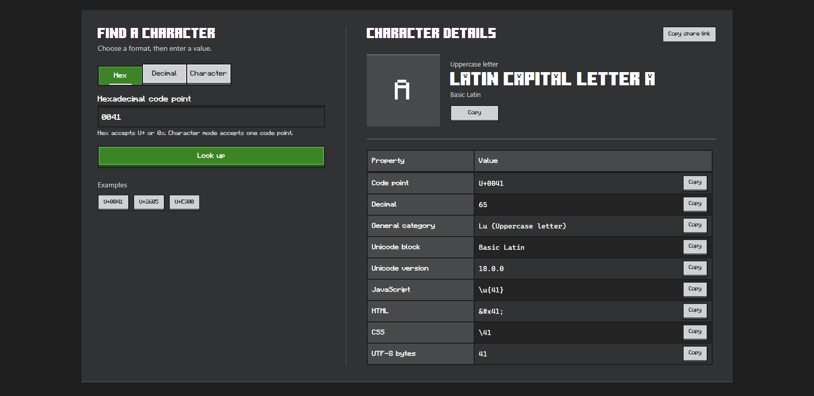

# Unicode Lookup

> NOT AN OFFICIAL MINECRAFT PRODUCT. NOT APPROVED BY OR ASSOCIATED WITH MOJANG OR MICROSOFT.

Unicode Lookup is a client-side reference for Bedrock creators and anyone who needs to identify a Unicode code point. It is designed as a lightweight alternative to the Unicode lookup linked from Bedrock Wiki.

Search by hexadecimal value, decimal value, or one character. Results include the Unicode name, general category, block, code point, decimal value, and copy-ready escape values. Private Use Area values are included across all three ranges.



The site uses Katorly's [OreUI React package](https://github.com/katorlys/OreUI), an unofficial component library for the Ore UI design language. OreUI is licensed under MPL-2.0. This project is independent and is not affiliated with or endorsed by Mojang or Microsoft.

## Features

- Search valid Unicode scalar values from U+0000 to U+10FFFF.
- Look up supplementary characters, unassigned code points, noncharacters, and Private Use Area values.
- Copy the character, code point, decimal value, general category, JavaScript escape, HTML reference, CSS escape, or UTF-8 bytes.
- Share a lookup with a URL such as `?code=E300`.
- Load character metadata from local static assets. The site sends no lookup data to an API.
- Use the interface on desktop, tablet, and mobile with keyboard navigation and visible focus.

Surrogate code points cannot be represented as Unicode characters, so the lookup rejects U+D800 through U+DFFF. Character mode accepts one code point at a time. A multi-code-point sequence, such as a joined emoji, can be looked up one code point at a time.

Private Use Area characters have no standard name or assigned appearance. Their glyph depends on the font or resource pack used by the viewer. The preview therefore shows the glyph available in the current browser and device.

## Local development

Install Node.js 22.12 or later and Python 3.10 or later. Python is only needed when regenerating the Unicode data.

```sh
npm ci
npm run dev
```

The development server prints a local URL. Vite serves the app with its development reload support.

## Checks and builds

```sh
npm run typecheck
npm test
npm run build
```

The production site is written to `dist`. To inspect that build locally, run `npm run preview`.

## Unicode data

The project includes generated metadata from Unicode 18.0.0. It stores character names, general categories, combining classes, name aliases, and Unicode block ranges. Metadata is split into local assets covering 8,192 code points each, so the site loads only the segment needed for a character.

Regenerate the checked-in metadata with:

```sh
npm run data:update
```

This downloads the official Unicode Character Database archive and Terms of Use from the Unicode Consortium. It uses Python's standard library and writes the generated assets under `src/data/unicode`.

Unicode data remains subject to the Unicode Consortium's [Terms of Use](https://www.unicode.org/terms_of_use.html). The generated data includes a local copy of those terms.

## GitHub Pages

The workflow in `.github/workflows/pages.yml` runs type checking, unit tests, and a production build on pull requests and pushes to `main` or `master`. A successful push to either branch deploys the `dist` artifact to GitHub Pages. The workflow also supports a manual run from either branch.

In the repository settings, set Pages to use GitHub Actions if it is not already enabled. The public URL uses the repository's GitHub Pages address and supports a code query such as `?code=E300`.

Vite builds with relative asset paths, which supports project sites served from a repository subpath.

## Project structure

- `src/App.tsx` contains the lookup experience and uses OreUI components directly.
- `src/main.tsx` loads the OreUI stylesheet once.
- `src/styles.css` contains the responsive page layout and theme token overrides.
- `src/lib/unicode.ts` parses input and formats copy-ready values.
- `src/lib/metadata.ts` resolves character metadata from lazy-loaded Unicode segments.
- `src/data/unicode` contains the generated Unicode 18.0.0 metadata and its license terms.
- `tools/update-unicode-data.py` recreates the generated data from the official UCD archive.
- `.github/workflows/pages.yml` checks and deploys the site.

## License

The website source is available under the MIT License. Unicode data files remain subject to the Unicode Consortium's Terms of Use.
